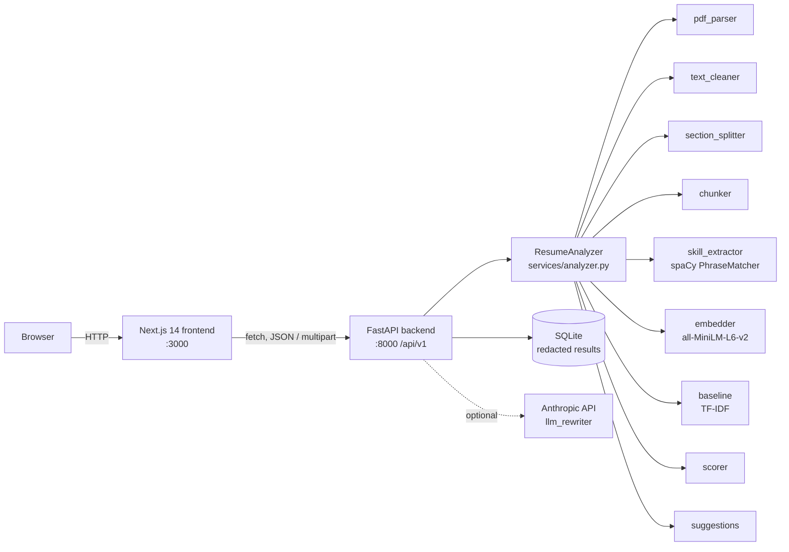
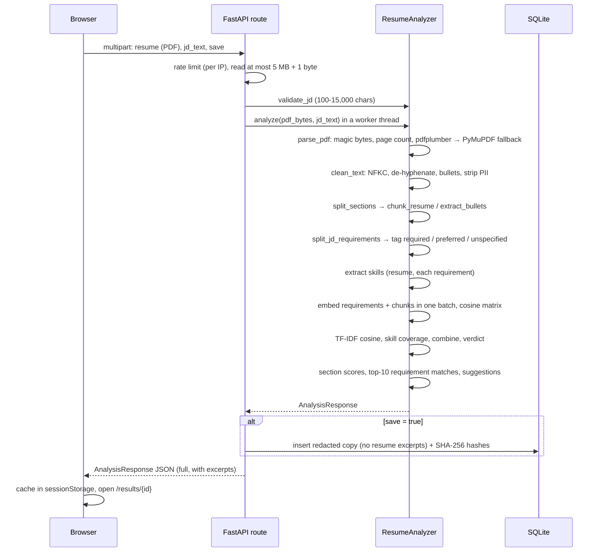

# ResumeLens


<!-- Replace the CI badge with your workflow badge once CI exists, e.g.
 -->

ResumeLens compares a resume (PDF) with a job description and explains the result. It returns a 0-100 match
score built from three measurable signals: **skill coverage** (rule-based matching against a curated
taxonomy of 423 skills), **semantic similarity** (sentence embeddings of each job requirement against each
resume bullet) and **keyword overlap** (a TF-IDF baseline). Alongside the score it lists matched and
missing skills (required vs. nice-to-have), shows which resume line best answers each requirement,
scores each resume section, and gives deterministic, rule-based suggestions. The resume text is never
stored. A built-in evaluation harness measures how well the score agrees with human judgments, so any
accuracy claim about the project can be backed by numbers you measured yourself.

### Screenshots

No screenshots are committed. To add your own:

1. Run the app (see [Installation](#installation-and-running-locally)) and analyze a resume you are allowed to share.
2. Save PNGs to `docs/screenshots/` (create the folder), for example `analyzer.png`, `results.png`,
   `results-dark.png`, `history.png`.
3. Reference them here:

```markdown


```

Crop out any personal details before committing.

---

## Table of contents

- [Features](#features)
- [How it works](#how-it-works)
- [Scoring methodology](#scoring-methodology)
- [NLP concepts used](#nlp-concepts-used)
- [Tech stack](#tech-stack)
- [Project structure](#project-structure)
- [Prerequisites](#prerequisites)
- [Installation and running locally](#installation-and-running-locally)
- [Configuration reference](#configuration-reference)
- [API reference](#api-reference)
- [Frontend guide](#frontend-guide)
- [Testing](#testing)
- [Evaluation methodology](#evaluation-methodology)
- [Deployment guide](#deployment-guide)
- [Privacy and security](#privacy-and-security)
- [Performance notes](#performance-notes)
- [Troubleshooting and FAQ](#troubleshooting-and-faq)
- [Limitations and known issues](#limitations-and-known-issues)
- [Roadmap](#roadmap)
- [Extending the project](#extending-the-project)
- [Contributing, license and acknowledgements](#contributing-license-and-acknowledgements)
- [Glossary](#glossary)

---

## Features

### Core

- Upload a resume PDF (max 5 MB, 10 pages) and paste a job description (100-15,000 characters).
- Overall score (0-100, one decimal) and a verdict: Weak, Partial, Strong or Excellent match.
- Score breakdown into skill coverage, semantic similarity and keyword overlap, with the weights used.
- Matched, missing and extra skills, grouped into 11 categories, with each JD skill tagged
  `required`, `preferred` or `unspecified`.
- Per-section similarity for summary, experience, projects, skills, education and other.
- Resume statistics: pages, words, bullets, and the share of bullets containing a number.
- Rule-based suggestions in three priorities: missing required skills, missing metrics, weak opening
  verbs, length, missing sections, long bullets, low alignment.
- Optional "Rewrite this bullet" powered by the Anthropic API, which refuses to invent metrics and
  inserts placeholders such as `[X%]` instead.
- History of saved analyses with pagination.

### Explainability

- **Requirement matches:** for the 10 most important JD requirements, the single resume excerpt that
  matched best and its cosine similarity.
- Every weight and band is returned in the response and shown in the UI.
- The About page reads the live scoring configuration from `GET /api/v1/health`.
- A JD with no detectable skills is handled explicitly: the skill weight is redistributed and the user is told so.

### Privacy

- Resume text is never written to the database or to logs.
- Emails, phone numbers and URLs are stripped before any analysis.
- Saved analyses are redacted (no resume excerpts) and identified by a SHA-256 hash of the file.
- `save=false` stores nothing at all.
- Delete one analysis or the entire history through the API or UI.

### Developer experience

- Typed end to end: Pydantic v2 models mirrored exactly by TypeScript types, enforced by a contract test.
- Backend tests with in-memory PDF generation (no binary fixtures) and high coverage of `services/`.
- Evaluation harness with Spearman, Pearson, MAE, bootstrap confidence intervals, ablation and
  train/test weight tuning.
- One `docker compose up --build` for the whole stack; multi-stage images that run as non-root.
- Structured JSON logs with request IDs; OpenAPI docs at `/docs`.

---

## How it works

### Architecture



The same diagram as plain text:

```
Browser ──> Next.js (:3000) ──> FastAPI (:8000)/api/v1
                                   │
                                   ├── ResumeAnalyzer
                                   │     pdf_parser → text_cleaner → section_splitter → chunker
                                   │     skill_extractor (spaCy) · embedder (MiniLM) · baseline (TF-IDF)
                                   │     scorer → suggestions
                                   ├── SQLite (scores, skills, suggestions, hashes; no resume text)
                                   └── Anthropic API (optional, /rewrite-bullet only)
```

### Data flow of one `POST /api/v1/analyze`



### The pipeline, step by step

| Step | Module (`backend/app/services/`) | What it does |
|---|---|---|
| 1 | `pdf_parser.py` | Rejects empty files (400), files over the size limit (413), files without the `%PDF` header (415), PDFs over the page limit (413), and encrypted or corrupted PDFs (422). Extracts text with pdfplumber; if that yields fewer than 100 characters, retries with PyMuPDF and keeps the longer result. If the text is still under 100 characters, raises `UnreadablePDFError` ("No extractable text; OCR is not supported"), noting when the PDF contains images (a scan). |
| 2 | `text_cleaner.py` | NFKC unicode normalisation (fixes ligatures such as "fi"), removes `(cid:NN)` artifacts, joins hyphenated line breaks, collapses whitespace, unifies bullet glyphs (`•`, `▪`, `●`, `-`, `*`, Word symbol-font bullets) to `•`, and drops separator lines. Produces `structured` (line structure kept) and `for_embedding` (emails, URLs, profile links and 10-15 digit phone numbers removed). |
| 3 | `section_splitter.py` | Detects headings with a regex dictionary: short lines that fully match patterns such as `(professional\|work\|relevant)? experience`, `technical skills`, `academic projects`, also spaced-out headings like `E X P E R I E N C E`. Certifications, awards, publications and similar map to `other`. Text before the first heading becomes `summary` if it has at most 80 words, otherwise `other`. |
| 4 | `chunker.py` | Resume: each bullet (with wrapped continuation lines) or sentence is a unit; units of 8+ words are standalone chunks, shorter ones are grouped to about 15 words; chunks are capped at 80 words. JD: each bullet or sentence of 3+ words becomes a requirement, tagged by cue phrases ("must have", "required", "at least", "3+ years" → required; "nice to have", "a plus", "preferred", "bonus" → preferred) or by its JD heading ("Requirements", "Nice to have", "Responsibilities"). "About us", "Benefits", EEO and similar blocks are skipped. At most 60 requirements are kept. |
| 5 | `skill_extractor.py` | spaCy `PhraseMatcher(attr="LOWER")` over `data/skills.json`, plus a case-sensitive matcher for ambiguous names (`Go`, `R`, `Rust`, `Spring`, `Excel`, `REST`). Symbol-heavy names are pre-normalised on both text and patterns (`C++` → `cplusplus`, `C#` → `csharp`, `.NET` → `dotnet`, `Node.js` → `nodejs`, `CI/CD` → `cicd`). Overlaps keep the longest span; aliases resolve to canonical names. |
| 6 | `embedder.py` | `sentence-transformers` `all-MiniLM-L6-v2` on CPU, loaded once at startup, `normalize_embeddings=True`, batched. A per-request cache encodes each distinct string once. |
| 7 | `baseline.py` | `TfidfVectorizer(stop_words="english", ngram_range=(1, 2), sublinear_tf=True)` fitted on the two documents; cosine similarity of the full resume vs. the full JD. |
| 8 | `scorer.py` | Combines the signals (see [Scoring methodology](#scoring-methodology)). |
| 9 | `suggestions.py` | Deterministic rules using `data/weak_verbs.json` (64 phrases) and `data/strong_verbs.json` (70 verbs). |
| 10 | `llm_rewriter.py` | Optional `POST /api/v1/rewrite-bullet` via the Anthropic API. |
| — | `analyzer.py` | Orchestrates steps 1-9 and builds the response. |

---

## Scoring methodology

All defaults live in `backend/app/config.py` and can be overridden with environment variables
(see [Configuration reference](#configuration-reference)).

### Skill coverage

Let `J` be the set of skills found in the JD's requirement sentences, each with a tag. A skill that
appears under several tags takes the strongest (required > unspecified > preferred).

```
w(required) = 2.0    w(unspecified) = 1.0    w(preferred) = 0.5

skill_coverage = 100 × Σ_{s ∈ J, s on resume} w(tag(s)) / Σ_{s ∈ J} w(tag(s))
```

If `J` is empty, skill coverage is undefined; see redistribution below.

**Limitations:** only skills in the taxonomy are seen; "Python or Java" counts both as needed; a skill
listed in a Skills section counts the same as one demonstrated in a bullet.

### Semantic similarity

For JD requirement sentences `r_1..r_n` and resume chunks `c_1..c_m`, with normalised embeddings:

```
raw_semantic = (1/n) Σ_i max_j cos(r_i, c_j)
semantic_similarity = clip( (raw_semantic − 0.20) / (0.75 − 0.20) × 100, 0, 100 )
```

Cosine values from MiniLM rarely span the full −1..1 range for English text; unrelated sentences
often still score above zero and close paraphrases rarely reach 1. The band `[SEMANTIC_FLOOR,
SEMANTIC_CEILING]` maps the useful range onto 0-100. **The default band is a starting point, not a
calibrated value**: use the evaluation harness to check it on your data.

**Limitations:** the max over chunks rewards one good bullet per requirement and ignores how many bullets
support it; embeddings capture topic and paraphrase but are weak at negation ("no experience with X"),
numbers and seniority.

### Keyword overlap

```
keyword_overlap = clip( (tfidf_cosine − 0.02) / (0.40 − 0.02) × 100, 0, 100 )
```

**Limitations:** purely lexical, so synonyms score zero ("built HTTP services" vs. "REST API development");
fitting IDF on only two documents makes IDF weights coarse; long resumes dilute the score.

### Combination

```
overall_score = 0.50 × skill_coverage + 0.35 × semantic_similarity + 0.15 × keyword_overlap
```

Weights are normalised to sum to 1, so `WEIGHT_SKILL=5, WEIGHT_SEMANTIC=3.5, WEIGHT_KEYWORD=1.5`
is equivalent to the defaults. The result is clipped to 0-100 and rounded to one decimal. The weights
actually applied are returned as `score_breakdown.weights`.

**Zero-skill JDs.** If no known skill appears in the JD, the skill weight is redistributed
proportionally: with the defaults, semantic becomes 0.35/0.50 = 0.70 and keyword 0.15/0.50 = 0.30.
`score_breakdown.skill_weight_redistributed` is `true` and a `no_skills_in_jd` suggestion explains it.

**Why these weights?** Skill coverage is the most direct and interpretable evidence of fit, so it
carries half the weight. Semantic similarity catches paraphrase and context. Keyword overlap gets a
small weight because ATS systems often match literally, but it is the noisiest signal. These are
reasoned defaults, not fitted values; `evaluate.py --tune` searches for better ones on held-out data.

### Verdicts

Computed from the rounded score:

| Score | Verdict |
|---|---|
| < 40 | Weak match |
| 40 to 64.9 | Partial match |
| 65 to 84.9 | Strong match |
| ≥ 85 | Excellent match |

Thresholds are constants in `scorer.py` (`VERDICT_PARTIAL`, `VERDICT_STRONG`, `VERDICT_EXCELLENT`).

### Section scores and requirement matches

Each section's score uses the same formula as semantic similarity, restricted to that section's chunks.
Requirement matches list the top 10 requirements (required first, then unspecified, then preferred, in
JD order) with the argmax chunk and its raw cosine (−1 to 1, rounded to 3 decimals). In the UI, ≥ 0.6 is
labelled Strong, ≥ 0.4 Partial and below that Weak; these cut-offs are a reading aid only.

---

## NLP concepts used

**Tokenization** (`skill_extractor.py`, `baseline.py`). Splitting text into tokens. spaCy's rule-based
tokenizer splits on whitespace and punctuation with exceptions; symbols in names like `C++` can be
split inconsistently, which is why both the text and the patterns are pre-normalised.

**Named entity recognition vs. rule-based matching** (`skill_extractor.py`). NER is a statistical model
that labels spans such as people or organisations; general-purpose models are not trained to label
skills and would need annotated data. Rule-based matching against a curated list is predictable,
explainable and testable, at the cost of only finding listed skills. ResumeLens uses spaCy for
tokenization and matching, not NER.

**PhraseMatcher** (`skill_extractor.py`). Matches token sequences against many patterns efficiently.
`attr="LOWER"` compares lowercase forms (case-insensitive); `attr="ORTH"` compares exact text, used for
ambiguous names like `Go` that are only skills when capitalised. `filter_spans` keeps the longest
non-overlapping matches.

**TF-IDF** (`baseline.py`). Term frequency × inverse document frequency weights words that are frequent
in one document but rare across documents. `sublinear_tf` uses 1 + log(tf) so repeated words don't
dominate; bigrams capture phrases like "machine learning".

**Sentence embeddings** (`embedder.py`). A transformer encodes a sentence into a fixed-length vector
(384 dimensions for all-MiniLM-L6-v2) so that sentences with similar meaning are close together.
MiniLM-L6 is a small distilled model, chosen because it runs acceptably on CPU.

**Cosine similarity** (`embedder.py`, `baseline.py`). The cosine of the angle between two vectors. With
L2-normalised vectors it equals their dot product, so the full requirement × chunk matrix is one matrix
multiplication.

**Why embeddings beat TF-IDF on paraphrase, and where they fail.** TF-IDF only counts shared words, so
"developed HTTP endpoints in Python" and "REST API development" share almost nothing. Embeddings
place them close because they were trained on paraphrase data. They fail on negation, numbers and
quantities ("2 years" vs. "8+ years"), very rare jargon, and long inputs: this model truncates input
at 256 word-pieces, one reason resumes are chunked.

---

## Tech stack

### Backend (`backend/requirements.txt`, `backend/requirements-dev.txt`)

| Library | Version | Why |
|---|---|---|
| Python | 3.11 | Supported by every dependency below; required by the Docker image |
| FastAPI | 0.115.6 | Typed async API with automatic OpenAPI docs |
| Uvicorn (standard) | 0.32.1 | ASGI server |
| python-multipart | 0.0.20 | Multipart file uploads in FastAPI |
| Pydantic | 2.10.4 | Request/response validation and serialisation |
| pydantic-settings | 2.7.0 | Environment-variable configuration |
| SQLAlchemy | 2.0.36 | ORM for the SQLite history store |
| pdfplumber | 0.11.4 | Primary PDF text extraction, good reading order |
| PyMuPDF | 1.24.14 | Fallback extraction, page counting, encryption and image detection |
| spaCy | 3.8.3 | Tokenizer and PhraseMatcher (model `en_core_web_sm` 3.8.0) |
| NumPy | 1.26.4 | Vector maths |
| scikit-learn | 1.5.2 | TF-IDF baseline; Cohen's kappa in evaluation |
| PyTorch | 2.5.1 | Runtime for sentence-transformers (CPU build in Docker) |
| transformers | 4.46.3 | Model loading for sentence-transformers |
| huggingface-hub | 0.26.5 | Model download and caching |
| sentence-transformers | 3.3.1 | Sentence embeddings |
| anthropic | 0.45.2 | Optional bullet rewriter |
| httpx | 0.28.1 | HTTP client (Anthropic SDK, FastAPI TestClient) |
| pytest / pytest-cov | 8.3.4 / 6.0.0 | Tests and coverage |
| reportlab | 4.2.5 | Generates test PDFs in memory |
| ruff | 0.8.4 | Linting and formatting |
| SciPy | 1.14.1 | Spearman and Pearson correlations in evaluation |

### Frontend (`frontend/package.json`)

| Library | Version | Why |
|---|---|---|
| Node.js | 20 LTS | Runtime for Next.js 14 |
| Next.js | 14.2.35 | App Router, production build, standalone server output |
| React / React DOM | 18.3.1 | UI |
| TypeScript | 5.6.3 | Strict typing |
| Tailwind CSS | 3.4.17 | Styling with theme tokens; dark mode via `class` |
| PostCSS / Autoprefixer | 8.4.49 / 10.4.20 | Tailwind build pipeline |
| lucide-react | 0.468.0 | Icons |
| @fontsource IBM Plex Sans / Serif | 5.1.0 | Self-hosted fonts; no network needed at build time |
| ESLint / eslint-config-next / eslint-config-prettier | 8.57.1 / 14.2.35 / 9.1.0 | Linting |
| Prettier | 3.4.2 | Formatting |
| Vitest | 2.1.9 | Test runner |
| @vitejs/plugin-react | 4.3.4 | JSX in tests |
| Testing Library (react / dom / jest-dom / user-event) | 16.1.0 / 10.4.0 / 6.6.3 / 14.5.2 | Component tests |
| jsdom | 25.0.1 | Browser environment for tests |

---

## Project structure

```
resumelens/
├── docker-compose.yml          # backend + frontend, named volume for SQLite
├── .env.example                # settings read by docker-compose (copy to .env)
├── Makefile                    # setup, backend, frontend, test, lint, eval, docker-up/down, clean
├── LICENSE                     # MIT
├── README.md
├── backend/
│   ├── app/
│   │   ├── main.py             # app factory, lifespan (loads models, creates DB), middleware, CORS
│   │   ├── config.py           # every tunable as an env var (pydantic-settings)
│   │   ├── schemas.py          # Pydantic v2 request/response models (the API contract)
│   │   ├── db.py               # engine, sessions, SQLite WAL pragmas
│   │   ├── models.py           # Analysis table (redacted JSON result + hashes)
│   │   ├── errors.py           # typed errors and the {"error": {code, message}} handlers
│   │   ├── middleware.py       # request IDs, JSON logging, in-memory rate limiter
│   │   ├── api/routes.py       # /api/v1 endpoints
│   │   ├── services/
│   │   │   ├── pdf_parser.py   # validation + extraction with fallback
│   │   │   ├── text_cleaner.py # normalisation, bullets, PII stripping, tech-term normalisation
│   │   │   ├── section_splitter.py
│   │   │   ├── chunker.py      # resume chunks, bullets, JD requirements and tags
│   │   │   ├── skill_extractor.py
│   │   │   ├── embedder.py     # MiniLM loader, per-request cache, cosine matrix
│   │   │   ├── baseline.py     # TF-IDF cosine
│   │   │   ├── scorer.py       # coverage, rescaling, combination, verdicts
│   │   │   ├── suggestions.py  # rule engine
│   │   │   ├── llm_rewriter.py # optional Anthropic rewrite with number guard
│   │   │   └── analyzer.py     # orchestrates the pipeline; redaction for storage
│   │   └── data/
│   │       ├── skills.json     # 423 skills, 11 categories, aliases + case-sensitive aliases
│   │       ├── weak_verbs.json
│   │       └── strong_verbs.json
│   ├── data/                   # SQLite database is created here (git-ignored)
│   ├── tests/                  # pytest suite; conftest builds PDFs with reportlab
│   │   └── test_contract.py    # backend schemas == frontend/src/types/api.ts
│   ├── evaluation/
│   │   ├── evaluate.py         # metrics, bootstrap CIs, ablation, --tune
│   │   ├── RUBRIC.md           # labelling rubric and inter-rater agreement
│   │   ├── pairs_template.csv  # CSV format with 3 EXAMPLE rows (ignored by the script)
│   │   └── data/               # put your resumes/JDs here (git-ignored)
│   ├── requirements.txt / requirements-dev.txt
│   ├── .env.example
│   ├── Dockerfile              # multi-stage, CPU torch, models baked in, non-root, HEALTHCHECK
│   ├── pytest.ini / ruff.toml / .dockerignore
└── frontend/
    ├── src/
    │   ├── app/                # layout, Analyze (/), results/[id], history, about, error, not-found
    │   ├── components/         # UI components + __tests__
    │   ├── lib/                # api.ts (typed client), format.ts, validation.ts, resultCache.ts
    │   └── types/api.ts        # mirror of backend schemas
    ├── public/favicon.svg
    ├── package.json / package-lock.json / tsconfig.json
    ├── next.config.js          # output: "standalone", security headers
    ├── tailwind.config.ts / postcss.config.js
    ├── .eslintrc.json / .prettierrc / .prettierignore
    ├── vitest.config.ts / vitest.setup.ts
    ├── .env.local.example
    └── Dockerfile              # multi-stage, standalone server, non-root
```

---

## Prerequisites

| Tool | Version | Check |
|---|---|---|
| Python | 3.11.x | `python --version` (Windows: `py -3.11 --version`) |
| Node.js | 20 LTS | `node --version` |
| npm | comes with Node 20 | `npm --version` |
| Git | any recent | `git --version` |
| Docker + Compose v2 (optional) | Docker 24+ | `docker --version` and `docker compose version` |

Notes:

- About 3 GB of free disk for the Python environment (PyTorch is large) and 1 GB for `node_modules`.
- **Intel Macs:** PyTorch 2.5.1 has no macOS x86_64 wheels. Use Docker, or Apple Silicon.
- **Linux without a GPU:** installing the CPU build of PyTorch first saves about 2 GB (shown below).

---

## Installation and running locally

Clone the repository:

```bash
git clone https://github.com/<OWNER>/<REPO>.git resumelens
cd resumelens
```

### Backend: Windows PowerShell

```powershell
cd backend
py -3.11 -m venv .venv
.\.venv\Scripts\Activate.ps1
python -m pip install --upgrade pip
pip install -r requirements.txt -r requirements-dev.txt
python -m spacy download en_core_web_sm
Copy-Item .env.example .env
uvicorn app.main:app --reload --port 8000
```

If activation is blocked, see [PowerShell execution policy](#powershell-blocks-venv-activation).

### Backend: macOS / Linux (bash)

```bash
cd backend
python3.11 -m venv .venv
source .venv/bin/activate
python -m pip install --upgrade pip
# Linux only, optional: CPU-only PyTorch (much smaller than the default CUDA build)
pip install torch==2.5.1 --index-url https://download.pytorch.org/whl/cpu
pip install -r requirements.txt -r requirements-dev.txt
python -m spacy download en_core_web_sm
cp .env.example .env
uvicorn app.main:app --reload --port 8000
```

**First run:** the embedding model (about 90 MB) downloads from Hugging Face when the server starts,
so the first startup takes longer and needs internet access. Docker images include the model.

### Frontend (second terminal)

Windows PowerShell:

```powershell
cd frontend
npm ci
Copy-Item .env.local.example .env.local
npm run dev
```

macOS / Linux:

```bash
cd frontend
npm ci
cp .env.local.example .env.local
npm run dev
```

(`npm ci` installs exactly what `package-lock.json` pins; `npm install` also works.)

### With make (macOS / Linux)

```bash
make setup      # venv, Python + Node dependencies, spaCy model, env files
make backend    # terminal 1
make frontend   # terminal 2
```

### Docker Compose

```bash
cp .env.example .env          # Windows PowerShell: Copy-Item .env.example .env
docker compose up --build
```

The first build downloads PyTorch, the spaCy model and the embedding model, so it takes several minutes.
The frontend starts after the backend's health check passes. Stop with `docker compose down`
(the history database survives in the `resumelens-data` volume; add `-v` to delete it).

### Verify

1. API docs: open <http://localhost:8000/docs>.
2. Health check:

   ```bash
   curl http://localhost:8000/api/v1/health
   ```

   PowerShell: `Invoke-RestMethod http://localhost:8000/api/v1/health`. Expect `"status":"ok"`,
   `"spacy_loaded":true` and `"embedder_loaded":true`.
3. App: open <http://localhost:3000>, upload a text-based PDF, paste a job description, click
   **Analyze resume**.

---

## Configuration reference

### Backend (`backend/.env` or environment variables)

| Variable | Default | Type | Meaning |
|---|---|---|---|
| `APP_NAME` | `ResumeLens` | str | Name shown at `/` |
| `APP_VERSION` | `1.0.0` | str | Returned in `/health` and `model_info.version` |
| `ENVIRONMENT` | `development` | str | Free-form label |
| `LOG_LEVEL` | `INFO` | str | `DEBUG`, `INFO`, `WARNING`, `ERROR` |
| `DATABASE_URL` | `sqlite:///<backend>/data/resumelens.db` | str | SQLAlchemy URL; Docker uses `sqlite:////app/data/resumelens.db` |
| `CORS_ORIGINS` | `http://localhost:3000` | str | Comma-separated allowed browser origins |
| `RATE_LIMIT_ENABLED` | `true` | bool | Enable the per-IP limiter |
| `RATE_LIMIT_PER_MINUTE` | `20` | int | Requests per minute per IP, separately for `/analyze` and `/rewrite-bullet` |
| `EMBEDDING_MODEL` | `all-MiniLM-L6-v2` | str | Any sentence-transformers model name |
| `EMBEDDING_BATCH_SIZE` | `32` | int | Encoding batch size |
| `MODEL_CACHE_DIR` | unset | str | Model cache folder (Docker: `/opt/models`) |
| `SPACY_MODEL` | `en_core_web_sm` | str | spaCy pipeline; falls back to a blank English tokenizer if missing |
| `PRELOAD_MODELS` | `true` | bool | Load the embedding model at startup instead of on first request |
| `MAX_UPLOAD_MB` | `5` | float | Max resume size |
| `MAX_PDF_PAGES` | `10` | int | Max resume pages |
| `MIN_JD_CHARS` | `100` | int | Min JD length (after trimming) |
| `MAX_JD_CHARS` | `15000` | int | Max JD length |
| `CHUNK_MIN_WORDS` | `15` | int | Target minimum words when grouping short resume units |
| `CHUNK_MAX_WORDS` | `80` | int | Maximum words per resume chunk |
| `MAX_JD_REQUIREMENTS` | `60` | int | Requirement sentences kept from a JD |
| `TOP_REQUIREMENT_MATCHES` | `10` | int | Rows in `requirement_matches` |
| `MAX_EXTRA_SKILLS` | `15` | int | Cap on `extra_skills` |
| `WEIGHT_SKILL` | `0.50` | float | Skill coverage weight (normalised) |
| `WEIGHT_SEMANTIC` | `0.35` | float | Semantic similarity weight |
| `WEIGHT_KEYWORD` | `0.15` | float | Keyword overlap weight |
| `SKILL_WEIGHT_REQUIRED` | `2.0` | float | Coverage weight of required JD skills |
| `SKILL_WEIGHT_UNSPECIFIED` | `1.0` | float | Coverage weight of untagged JD skills |
| `SKILL_WEIGHT_PREFERRED` | `0.5` | float | Coverage weight of nice-to-have JD skills |
| `SEMANTIC_FLOOR` / `SEMANTIC_CEILING` | `0.20` / `0.75` | float | Cosine band mapped to 0-100 |
| `KEYWORD_FLOOR` / `KEYWORD_CEILING` | `0.02` / `0.40` | float | TF-IDF band mapped to 0-100 |
| `ANTHROPIC_API_KEY` | empty | str | Enables `/rewrite-bullet`; empty means 501 |
| `ANTHROPIC_MODEL` | `claude-haiku-4-5-20251001` | str | Model used by the rewriter |
| `LLM_MAX_TOKENS` | `300` | int | Max output tokens for a rewrite |
| `LLM_TIMEOUT_SECONDS` | `30` | float | Provider timeout |

Invalid combinations (floor ≥ ceiling, all weights zero, min ≥ max) stop the app at startup with a clear error.

### Frontend (`frontend/.env.local`)

| Variable | Default | Meaning |
|---|---|---|
| `NEXT_PUBLIC_API_URL` | `http://localhost:8000` | Backend base URL used by the browser. Inlined at build time: rebuild after changing it. |

### Docker Compose (root `.env`)

`CORS_ORIGINS`, `NEXT_PUBLIC_API_URL`, `LOG_LEVEL`, `RATE_LIMIT_PER_MINUTE`, `WEIGHT_SKILL`,
`WEIGHT_SEMANTIC`, `WEIGHT_KEYWORD`, `ANTHROPIC_API_KEY`, `ANTHROPIC_MODEL`. To pass any other backend
variable, add it under `services.backend.environment` in `docker-compose.yml`.

---

## API reference

Base URL: `http://localhost:8000/api/v1`. Interactive docs: `/docs` (Swagger UI) and `/redoc`.
Every response carries an `X-Request-ID` header (send your own to correlate logs).

### Error format

All errors use one shape:

```json
{ "error": { "code": "file_too_large", "message": "Resume must be at most 5 MB." } }
```

| Status | `code` values |
|---|---|
| 400 | `bad_request`, `empty_file` |
| 404 | `not_found` |
| 413 | `file_too_large`, `too_many_pages` |
| 415 | `unsupported_media_type` |
| 422 | `unreadable_pdf`, `encrypted_pdf`, `invalid_job_description`, `validation_error` |
| 429 | `rate_limited` (with a `Retry-After` header) |
| 500 | `internal_error` |
| 501 | `feature_unavailable` |
| 502 | `upstream_error` (LLM provider failed) |

### `GET /health`

Liveness, model status and the active scoring configuration. Always 200; `status` is `degraded` if a
model failed to load.

```bash
curl http://localhost:8000/api/v1/health
```

```json
{
  "status": "ok",
  "version": "1.0.0",
  "models": {
    "spacy_loaded": true,
    "spacy_model": "en_core_web_sm",
    "embedder_loaded": true,
    "embedding_model": "all-MiniLM-L6-v2",
    "skills_count": 423
  },
  "llm_enabled": false,
  "config": {
    "weights": { "skill_coverage": 0.5, "semantic_similarity": 0.35, "keyword_overlap": 0.15 },
    "semantic_band": { "floor": 0.2, "ceiling": 0.75 },
    "keyword_band": { "floor": 0.02, "ceiling": 0.4 },
    "skill_priority_weights": { "required": 2.0, "unspecified": 1.0, "preferred": 0.5 },
    "verdict_thresholds": { "partial": 40.0, "strong": 65.0, "excellent": 85.0 },
    "limits": { "max_upload_mb": 5.0, "max_pdf_pages": 10, "min_jd_chars": 100, "max_jd_chars": 15000 }
  }
}
```

### `POST /analyze`

Multipart form: `resume` (file), `jd_text` (string), `save` (boolean, default `true`). Rate limited.
Status codes: 200, 400, 413, 415, 422, 429, 500.

```bash
curl -X POST http://localhost:8000/api/v1/analyze \
  -F "resume=@resume.pdf;type=application/pdf" \
  -F "jd_text=<job.txt" \
  -F "save=true"
```

PowerShell 7+:

```powershell
$form = @{ resume = Get-Item .\resume.pdf; jd_text = (Get-Content .\job.txt -Raw); save = "true" }
Invoke-RestMethod -Method Post -Uri http://localhost:8000/api/v1/analyze -Form $form
```

Response (values are illustrative; lists shortened):

```json
{
  "analysis_id": "7c39e086833a48fc9620aecee0011ca9",
  "created_at": "2026-10-03T21:04:44.139030Z",
  "overall_score": 61.4,
  "verdict": "Partial match",
  "score_breakdown": {
    "skill_coverage": 77.5,
    "semantic_similarity": 48.2,
    "keyword_overlap": 32.0,
    "weights": { "skill_coverage": 0.5, "semantic_similarity": 0.35, "keyword_overlap": 0.15 },
    "raw_semantic_cosine": 0.465,
    "raw_keyword_cosine": 0.1416,
    "skill_weight_redistributed": false
  },
  "matched_skills": [{ "name": "Python", "category": "language", "in_jd_as": "required" }],
  "missing_skills": [
    { "name": "Kubernetes", "category": "devops", "in_jd_as": "required" },
    { "name": "Terraform", "category": "devops", "in_jd_as": "preferred" }
  ],
  "extra_skills": [{ "name": "C++", "category": "language" }],
  "section_scores": [{ "section": "experience", "similarity": 0.512, "score": 56.7, "word_count": 50 }],
  "requirement_matches": [
    {
      "requirement": "Strong SQL skills and experience with PostgreSQL",
      "requirement_type": "required",
      "best_chunk": "Built a REST API in Python with FastAPI and PostgreSQL serving 12,000 daily users",
      "best_chunk_section": "experience",
      "similarity": 0.58
    }
  ],
  "suggestions": [
    {
      "type": "missing_required_skill",
      "priority": "high",
      "message": "The job lists Kubernetes as required, but it was not found on your resume. ..."
    }
  ],
  "resume_stats": { "pages": 1, "word_count": 118, "bullet_count": 5, "bullets_with_numbers_pct": 40.0 },
  "model_info": { "embedding_model": "all-MiniLM-L6-v2", "spacy_model": "en_core_web_sm", "version": "1.0.0" },
  "stored": true,
  "redacted": false
}
```

`stored` says whether the result was saved; `redacted` is `true` for copies read back from the
database, where every `best_chunk` is `null`.

### `GET /analyses?limit=20&offset=0`

Paginated history, newest first. `limit` 1-100 (default 20), `offset` ≥ 0. Status: 200, 422.

```bash
curl "http://localhost:8000/api/v1/analyses?limit=20&offset=0"
```

```json
{
  "items": [
    {
      "analysis_id": "7c39e086833a48fc9620aecee0011ca9",
      "created_at": "2026-10-03T21:04:44.139030Z",
      "overall_score": 61.4,
      "verdict": "Partial match",
      "top_missing_skills": ["Kubernetes", "Terraform"]
    }
  ],
  "total": 1,
  "limit": 20,
  "offset": 0
}
```

### `GET /analyses/{id}`

The stored (redacted) `AnalysisResponse`. Status: 200, 404.

```bash
curl http://localhost:8000/api/v1/analyses/7c39e086833a48fc9620aecee0011ca9
```

### `DELETE /analyses/{id}`

Status: 200 `{"deleted": 1}`, 404.

```bash
curl -X DELETE http://localhost:8000/api/v1/analyses/7c39e086833a48fc9620aecee0011ca9
```

### `DELETE /analyses`

Deletes all history. Status: 200 `{"deleted": <count>}`.

```bash
curl -X DELETE http://localhost:8000/api/v1/analyses
```

### `POST /rewrite-bullet` (optional)

JSON body: `bullet` (5-600 chars), `target_skills` (optional, up to 10 strings), `jd_context` (optional,
up to 2,000 chars). Rate limited. Status: 200, 422, 429, 501 (no API key), 502.

```bash
curl -X POST http://localhost:8000/api/v1/rewrite-bullet \
  -H "Content-Type: application/json" \
  -d '{"bullet": "Worked on the backend API for the student portal", "target_skills": ["FastAPI"]}'
```

```json
{
  "original": "Worked on the backend API for the student portal",
  "rewritten": "Built the student portal's backend API with FastAPI, reducing response times by [X%]",
  "placeholders": ["[X%]"],
  "model": "claude-haiku-4-5-20251001"
}
```

The system prompt forbids invented metrics. As a second guard, any number in the output that does not
appear in the input is replaced with `[X]`.

---

## Frontend guide

### Pages

| Route | File | What it does |
|---|---|---|
| `/` | `src/app/page.tsx` | Upload + JD form, client validation, "Save to history" toggle, progress status, error banner |
| `/results/[id]` | `src/app/results/[id]/page.tsx` | Full results; loading skeleton; not-found and error states |
| `/history` | `src/app/history/page.tsx` | Saved analyses, pagination, delete one, delete all (confirm dialog) |
| `/about` | `src/app/about/page.tsx` | Methodology, live scoring config from `/health`, limitations, privacy |
| errors | `src/app/error.tsx`, `src/app/not-found.tsx` | Error boundary and 404 page |

### Components (`src/components/`)

`UploadDropzone` (drag-and-drop, click or Enter/Space to browse, PDF/5 MB validation), `JobDescriptionInput`
(live character counter), `ScoreGauge` (SVG ring, animates once, respects reduced motion),
`ScoreBreakdown` (three meters with weights), `SkillChips` (grouped by category; missing-required
underlined), `SectionBars` (CSS bars), `RequirementMatches` (explainer table), `Suggestions` (grouped by
priority), `ResumeStats`, `BulletRewriter` (handles 501 with a notice), `HistoryTable`, `ConfirmDialog`
(native `<dialog>`), `ThemeToggle`, `ErrorBanner` (`role="alert"`), `Navbar`.

### State flow

1. `page.tsx` validates input and calls `analyzeResume()` from `src/lib/api.ts`.
2. The full response is cached in `sessionStorage` (`src/lib/resultCache.ts`) and the router opens
   `/results/{id}`.
3. The results page reads the cache first: it is the only place resume excerpts exist, and the only
   place an unsaved (`save=false`) analysis exists. Otherwise it calls `GET /analyses/{id}` and shows the
   redacted copy.
4. Errors from the API arrive as `ApiError { status, code, message }` and are mapped to friendly titles.

### Theme

- Colour tokens are CSS variables in `src/app/globals.css` (`:root` for light, `.dark` for dark),
  exposed to Tailwind in `tailwind.config.ts` (`bg-paper`, `text-ink`, `bg-lens`, `text-redpen`, ...).
  Change a hex value there and both themes follow.
- Dark mode uses Tailwind's `class` strategy. `ThemeToggle` writes `resumelens-theme` to
  `localStorage`; an inline script in `layout.tsx` applies it before first paint (falling back to the
  OS preference).
- Fonts: IBM Plex Sans for the interface, IBM Plex Serif for text quoted from the user's documents.
  Swap them by changing the `@fontsource` imports in `layout.tsx` and `fontFamily` in `tailwind.config.ts`.

---

## Testing

### Backend

```bash
cd backend
# activate the venv first (see Installation)
pytest                                                  # fast suite (real model test excluded)
pytest --cov=app/services --cov-report=term-missing     # with coverage of services/
pytest -m slow                                          # loads the real MiniLM model (~90 MB download)
ruff check app tests evaluation && ruff format --check app tests evaluation
```

The fast suite uses a deterministic hashed bag-of-words embedder (`tests/conftest.py`) so it runs
offline in seconds; everything else (PDF parsing, spaCy, SQLite, HTTP routes) is real. Test PDFs, including
scanned and encrypted ones, are generated in memory with reportlab. `tests/test_contract.py` fails if
`schemas.py` and `frontend/src/types/api.ts` drift apart.

### Frontend

```bash
cd frontend
npm run test        # Vitest + Testing Library
npm run lint        # ESLint, zero warnings allowed
npm run typecheck   # tsc --noEmit
npm run build       # production build
npm run format:check
```

### Adding tests

- Backend: add `backend/tests/test_<area>.py`. Use the fixtures in `conftest.py`: `make_pdf(lines)`,
  `make_image_only_pdf()`, `make_encrypted_pdf(lines)`, `analyzer` (pipeline with the fake embedder),
  `client` (TestClient with a clean database and rate limiter), `skill_extractor`, `verbs`.
- Frontend: add `src/**/__tests__/<Name>.test.tsx`; `vitest.setup.ts` loads jest-dom matchers.

---

## Evaluation methodology

The score is only meaningful if it agrees with human judgment. `backend/evaluation/` measures that.

### 1. Build a labelled dataset

1. Read `backend/evaluation/RUBRIC.md` (score anchors 0/25/50/75/100 and consistency rules).
2. Put resumes in `backend/evaluation/data/resumes/` and JD text files in `backend/evaluation/data/jds/`
   (git-ignored; never commit other people's resumes).
3. Copy the template and add about 50 rows:

   ```bash
   cp backend/evaluation/pairs_template.csv backend/evaluation/pairs.csv
   ```

   Columns: `pair_id,resume_pdf,jd_txt,human_score`; paths are relative to the CSV. Rows whose
   `pair_id` starts with `EXAMPLE` are ignored. For two labellers, add a `human_score_2` column.
4. Label each pair **before** looking at ResumeLens's output for it.

### 2. Run

```bash
cd backend
python evaluation/evaluate.py --pairs evaluation/pairs.csv
python evaluation/evaluate.py --pairs evaluation/pairs.csv --tune --test-size 0.3 --seed 42
```

or `make eval` / `make eval ARGS=--tune`. Options: `--out-dir`, `--bootstrap` (default 2000), `--grid-step`
(default 0.05). The script refuses to run with fewer than 10 labelled pairs and warns below 30.

It scores every pair with the production code and writes `results.md`, `results.csv` and
`per_pair_scores.csv` to `backend/evaluation/`.

### 3. Read the output

- **Spearman ρ** (main metric): does the method rank pairs in the same order as humans? 1 is perfect, 0 is none.
- **95% CI**: bootstrap interval for ρ. Wide intervals mean too few pairs; overlapping intervals mean
  you cannot claim one method beats another.
- **Pearson r**: linear agreement.
- **MAE**: mean absolute error in points; depends on the rescaling bands.
- **Ablation**: the combined score with each signal dropped. If dropping a signal doesn't lower ρ, it
  isn't helping on your data.
- **Tuning**: weights searched on the training split, reported **only** on the held-out test split.
- **Inter-rater agreement** (with `human_score_2`): Pearson and quadratic-weighted Cohen's κ between
  labellers; a practical ceiling for the model.

### 4. Results

Fill this table from your own `results.md`. Do not enter numbers that were not produced by `evaluate.py`.

| Method | n | Spearman ρ | 95% CI | Pearson r | MAE |
|---|---:|---:|---|---:|---:|
| TF-IDF baseline | | | | | |
| Embedding only | | | | | |
| Skills only | | | | | |
| Combined (default weights) | | | | | |
| Combined (tuned weights, test split) | | | | | |

Dataset: ___ pairs, ___ resumes, ___ JDs, labelled by ___ person(s); inter-rater κ: ___.

### How to describe this on a resume

Quote only values measured in your own `results.md`, and say what they were measured on. Template:

> Built ResumeLens, a resume/JD matcher (FastAPI, spaCy, sentence-transformers, Next.js); on **N**
> hand-labelled pairs its score reached Spearman **ρ = X** with human ratings versus **Y** for a TF-IDF
> baseline.

If the combined score did not beat the baseline, say so in interviews and explain what the ablation
showed. That is a stronger story than an unverifiable number.

---

## Deployment guide

### Docker Compose on a VPS

1. A VM with at least 2 GB RAM (the backend alone needs roughly 0.5-1 GB) and Docker installed.
2. Clone the repo and create `.env` in the root:

   ```bash
   CORS_ORIGINS=https://resumelens.example.com
   NEXT_PUBLIC_API_URL=https://api.resumelens.example.com
   ```

3. `docker compose up --build -d`.
4. Put a reverse proxy (Caddy or Nginx) in front for HTTPS, routing the frontend domain to port 3000
   and the API domain to port 8000. The backend runs uvicorn with `--proxy-headers`, so rate limiting
   sees real client IPs when the proxy sets `X-Forwarded-For` (trusted from localhost by default).
5. Back up the `resumelens-data` volume if you want to keep history.

### Frontend on Vercel + backend on Render

**Backend on Render (Docker web service):** root directory `backend`, environment Docker, port 8000.
Environment variables: `CORS_ORIGINS=https://<your-app>.vercel.app` and optionally `ANTHROPIC_API_KEY`.
Add a persistent disk mounted at `/app/data` if you need history to survive deploys; otherwise the
SQLite file is lost on redeploy. The smallest instance types may not have enough memory for the
embedding model; choose one with at least 1 GB.

**Frontend on Vercel:** import the repo, set the root directory to `frontend`, framework Next.js, and set
`NEXT_PUBLIC_API_URL=https://<your-backend>.onrender.com`. Redeploy after changing it (it is inlined at
build time).

### Backend on Hugging Face Spaces (Docker)

Create a Docker Space and push the contents of `backend/`. Spaces route traffic to the port declared
in the Space's README metadata (`app_port: 8000`). Spaces run containers as a different user ID than the
image's `app` user (10001), so if writing the database fails, set `DATABASE_URL=sqlite:////tmp/resumelens.db`
(history is then lost on restart) or rebuild the image with a matching UID. Set `CORS_ORIGINS` to your
frontend's origin as a Space secret or variable.

### CORS

The backend only accepts browser requests from origins listed in `CORS_ORIGINS` (exact scheme, host and
port, comma-separated, no trailing slash). The frontend's `NEXT_PUBLIC_API_URL` must point at the
backend's public URL, as seen from the user's browser, not from inside Docker.

### Cold starts and memory

- The model loads at startup (`PRELOAD_MODELS=true`); expect the first health check to take a while on
  small machines. The Docker health check allows a 60 s start period.
- Free tiers that sleep when idle will reload the model on wake.
- Run one uvicorn worker per container: each worker loads its own copy of the model, and the rate
  limiter is per process.

---

## Privacy and security

**Stored** (only when `save=true`): analysis ID, timestamp, scores, verdict, skill lists, section scores,
suggestions, JD requirement sentences with their similarity and section, SHA-256 of the PDF bytes and of
the JD text, model info.

**Never stored:** the PDF, the resume text, resume excerpts (`best_chunk` is set to `null` before saving),
contact details. Suggestions are written never to quote resume text.

**Never logged:** resume or JD text. Logs contain method, path, status, duration, client IP, request ID,
and counts/timings for analyses.

**Deletion:** `DELETE /api/v1/analyses/{id}` and `DELETE /api/v1/analyses`, also in the UI. In the
browser, full results live in `sessionStorage` and disappear when the tab closes.

**Upload validation:** read at most `MAX_UPLOAD_MB` + 1 byte; `%PDF` magic bytes; page limit; encrypted,
corrupted and image-only PDFs rejected. Pydantic validates every field.

**Rate limiting:** in-memory sliding window per IP, separate budgets for `/analyze` and `/rewrite-bullet`.

**LLM feature:** sends only the bullet the user pasted, chosen skills and a few JD requirements; user
content is wrapped in tags and the prompt tells the model to treat it as data.

**Hardening for production:**

- Serve both apps over HTTPS only; restrict `CORS_ORIGINS` to your real origin.
- Add authentication and per-user history (the current history is shared by everyone who can reach the API).
- Replace the in-memory rate limiter with Redis (or your proxy's limiter) when running several replicas.
- Put request size limits on the reverse proxy as well.
- Keep dependencies patched (`pip list --outdated`, `npm outdated`); scan images (e.g. Trivy).
- Set a retention policy (e.g. a cron job deleting analyses older than N days).
- Keep `ANTHROPIC_API_KEY` in a secret manager, never in the repo (`.env` files are git-ignored).

---

## Performance notes

No latency numbers are published here, because they depend entirely on hardware. Measure your own:

- **Where time goes:** each analysis logs `resume_ms` (PDF parsing, cleaning, chunking, resume skill
  extraction), `jd_ms` (JD splitting and skill extraction), `score_ms` (embedding, TF-IDF, scoring) and
  `total_ms`, in the `analysis_complete` JSON log line. On CPU, embedding usually dominates.
- **What is cached:** the model and spaCy pipeline load once per process; the PhraseMatcher is built
  once; within a request each distinct text is embedded once, in one batch.
- **What scales cost:** number of JD requirements (capped by `MAX_JD_REQUIREMENTS`) plus number of
  resume chunks, i.e. one embedding per sentence or bullet.
- **Profiling:**

  ```bash
  cd backend
  python -m cProfile -o profile.out -m uvicorn app.main:app --port 8000
  # send a few /analyze requests, stop the server, then:
  python -c "import pstats; pstats.Stats('profile.out').sort_stats('cumulative').print_stats(25)"
  ```

  Or attach `py-spy top --pid <uvicorn pid>` while sending requests.
- **Levers:** a smaller `MAX_JD_REQUIREMENTS`, larger `EMBEDDING_BATCH_SIZE` on machines with more cores,
  or a GPU build of PyTorch.

---

## Troubleshooting and FAQ

### spaCy model not found

`/health` shows `"spacy_model": "blank:en"` and status `degraded`. Run `python -m spacy download en_core_web_sm`
inside the activated venv. Matching still works with the blank fallback (it uses the same tokenizer rules).

### "No extractable text; OCR is not supported"

The PDF has no text layer (a scan or an image export). Re-export from Word, Google Docs or LaTeX with
"Save as PDF". Test: if you cannot select text in a PDF viewer, ResumeLens cannot read it either.

### Scanned PDFs

Not supported; OCR is on the [roadmap](#roadmap). The error message says when the PDF contains images.

### CORS errors in the browser console

The frontend's origin must be listed exactly in `CORS_ORIGINS` (e.g. `http://localhost:3000`, not
`http://127.0.0.1:3000`). Restart the backend after changing it.

### The frontend says it can't reach the server

Check `NEXT_PUBLIC_API_URL` in `frontend/.env.local`, restart `npm run dev` (or rebuild for production),
and confirm `curl http://localhost:8000/api/v1/health` works from the same machine.

### Port already in use

Run on another port: `uvicorn app.main:app --reload --port 8001` (then update `NEXT_PUBLIC_API_URL`) or
`npm run dev -- -p 3001` (then add that origin to `CORS_ORIGINS`). To find the process:
`lsof -i :8000` (macOS/Linux) or `netstat -ano | findstr :8000` (Windows).

### PowerShell blocks venv activation

"running scripts is disabled on this system": run once
`Set-ExecutionPolicy -Scope CurrentUser -ExecutionPolicy RemoteSigned`, or for the current window only
`Set-ExecutionPolicy -Scope Process -ExecutionPolicy Bypass`.

### The first request or startup is slow

The embedding model downloads (about 90 MB) and loads on first start. Later starts read it from the
local cache. Docker images ship with the model.

### PyTorch install fails on Windows

Use 64-bit Python 3.11 from python.org (not the Microsoft Store build if paths are too long), and enable
long paths: `git config --system core.longpaths true` plus the Windows "LongPathsEnabled" setting. If pip
still fails, install PyTorch first: `pip install torch==2.5.1 --index-url https://download.pytorch.org/whl/cpu`.

### "database is locked" (SQLite)

WAL mode is enabled, which avoids most cases. Make sure only one backend process uses the file, and that
it is not on a network drive or synced folder. Deleting `backend/data/resumelens.db` resets history.

### Docker build runs out of memory

Give Docker Desktop at least 4 GB RAM (Settings → Resources). The PyTorch install and model download are
the heavy steps.

### Wrong skills detected (or missing ones)

Matching is rule-based against `backend/app/data/skills.json`. Add an alias for a missing synonym; move an
ambiguous alias to `strict_aliases` so it only matches with exact capitalisation. See
[Extending the project](#extending-the-project).

### Results from History show "Not stored" instead of resume lines

Expected: resume excerpts are never saved. Re-run the analysis to see them.

### `pytest` can't find the `app` module

Run it from the `backend/` directory; `pytest.ini` adds that directory to the path.

---

## Limitations and known issues

- English only (spaCy English tokenizer, English stop words, an English-trained embedding model).
- No OCR: scanned PDFs are rejected.
- Multi-column and table-heavy layouts may extract in the wrong reading order, which hurts chunking
  and section detection.
- Skill detection only covers the 423 skills in the dataset; new tools need to be added by hand.
- "A or B" in a JD counts both A and B as required.
- Required/preferred tagging is heuristic (cue phrases and headings) and can be wrong for unusual
  postings.
- Section detection relies on recognisable headings.
- The default weights and bands are reasoned starting values, not calibrated ones, until you run the
  evaluation harness on labelled data.
- History is shared across everyone who can reach the backend (no authentication).
- The rate limiter is per process; it does not coordinate across replicas.
- PyTorch 2.5.1 does not support Intel Macs natively; use Docker there.

---

## Roadmap

- OCR fallback for scanned PDFs (e.g. Tesseract via `pytesseract`), clearly labelled as lower confidence.
- Multilingual support with a multilingual sentence-transformers model and language detection.
- A cross-encoder re-ranker for the top requirement matches, fine-tuned on labelled pairs.
- Understanding "A or B" alternatives and years-of-experience requirements.
- Skill-gap learning resources linked from missing skills.
- Authentication and per-user history; retention settings.
- CI pipeline (tests, lint, contract test, image build) with a real badge.

---

## Extending the project

### Add a skill

Edit `backend/app/data/skills.json` (one skill per line):

```json
{"canonical": "Svelte", "category": "frontend", "aliases": ["svelte", "sveltekit"]}
```

- `aliases` match case-insensitively; `strict_aliases` match only with exact case (use for words like
  `Go` that are also common English).
- `category` must be one of: `language`, `frontend`, `backend`, `database`, `cloud`, `devops`, `data_ml`,
  `testing`, `tools`, `concepts`, `soft_skill`.
- Canonical names must be unique (the loader raises on duplicates). Restart the backend and add a case to
  `tests/test_skill_extractor.py`.

### Swap the embedding model

Set `EMBEDDING_MODEL` to any sentence-transformers model (e.g. `all-mpnet-base-v2`, larger and slower).
Then re-run the evaluation: cosine distributions differ between models, so `SEMANTIC_FLOOR` and
`SEMANTIC_CEILING` usually need recalibrating. For Docker, also pass `--build-arg EMBEDDING_MODEL=...`
so the new model is baked into the image.

### Add a suggestion rule

1. Write a function in `backend/app/services/suggestions.py` that takes a `SuggestionContext` and calls
   `_add(ctx, "<type>", "<priority>", "<message>")`. Messages must not quote resume text.
2. Append it to `RULES`.
3. Add the new type to `SuggestionType` in `backend/app/schemas.py` **and** in
   `frontend/src/types/api.ts` (the contract test enforces this).
4. Test it in `tests/test_suggestions.py`.

### Add an endpoint

1. Add request/response models to `schemas.py` and mirror them in `frontend/src/types/api.ts`.
2. Add the route to `backend/app/api/routes.py` (raise subclasses of `AppError` from `errors.py` for
   failures so the error format stays consistent).
3. Add a typed function to `frontend/src/lib/api.ts`.
4. Add API tests to `tests/test_api.py` and run `pytest tests/test_contract.py`.

---

## Contributing, license and acknowledgements

**Contributing.** Open an issue first for larger changes. Before a pull request, run `make lint` and
`make test` (or the commands in [Testing](#testing)) and keep the contract test green. Never commit
real resumes, `.env` files or evaluation data.

**License.** MIT; see [LICENSE](LICENSE).

**Acknowledgements.**

- [ESCO](https://esco.ec.europa.eu/) (European Skills, Competences, Qualifications and Occupations) and
  [O\*NET](https://www.onetonline.org/) as inspiration for organising skills into a taxonomy. The skill
  list in this repository was written for this project; it is not an extract of either.
- [spaCy](https://spacy.io/) by Explosion.
- [sentence-transformers](https://www.sbert.net/) and the `all-MiniLM-L6-v2` model.
- [scikit-learn](https://scikit-learn.org/), [FastAPI](https://fastapi.tiangolo.com/),
  [pdfplumber](https://github.com/jsvine/pdfplumber), [PyMuPDF](https://pymupdf.readthedocs.io/),
  [Next.js](https://nextjs.org/), [Tailwind CSS](https://tailwindcss.com/), [Lucide](https://lucide.dev/),
  and IBM Plex.

---

## Glossary

| Term | Meaning |
|---|---|
| Ablation | Removing one component (here, one signal) to measure how much it contributes. |
| Alias | An alternative name for a skill that maps to its canonical name (`k8s` → Kubernetes). |
| App Router | Next.js 13+ routing system based on the `src/app` folder. |
| ASGI | The Python interface between async web servers (uvicorn) and frameworks (FastAPI). |
| ATS | Applicant tracking system: software employers use to collect and filter applications. |
| Band (rescaling) | The raw range `[floor, ceiling]` mapped linearly onto 0-100. |
| Bootstrap CI | A confidence interval obtained by resampling the data with replacement many times. |
| Canonical name | The single display name a skill resolves to. |
| Chunk | A short piece of the resume (a bullet or sentence group) that is embedded on its own. |
| Cohen's κ (kappa) | Agreement between two raters corrected for chance; "quadratic-weighted" penalises large disagreements more. |
| Contract test | A test checking that two sides of an interface (backend schemas, frontend types) match. |
| CORS | Cross-Origin Resource Sharing: browser rules for which sites may call an API. |
| Cosine similarity | The cosine of the angle between two vectors; 1 means the same direction. |
| Embedding | A vector representing the meaning of a text. |
| Health check | An endpoint or command that reports whether a service is running correctly. |
| IDF | Inverse document frequency: down-weights words that appear in many documents. |
| Lifespan | FastAPI's startup/shutdown hook, used to load models once. |
| MAE | Mean absolute error: the average absolute difference between predictions and labels. |
| Magic bytes | Fixed bytes at the start of a file identifying its format (`%PDF` for PDF). |
| MiniLM | A small transformer distilled from a larger one; `all-MiniLM-L6-v2` has 6 layers and 384-dimensional output. |
| Multipart form | The HTTP request format used to upload files with other form fields. |
| NER | Named entity recognition: a model that labels spans such as people or places. |
| NFKC | A Unicode normalisation form that also folds compatibility characters such as ligatures. |
| OCR | Optical character recognition: reading text from images. |
| Pearson r | Correlation measuring linear agreement between two variables. |
| PhraseMatcher | spaCy component that efficiently matches many token sequences. |
| PII | Personally identifiable information (emails, phone numbers, profile links). |
| Pydantic | Python library for data validation using type hints. |
| Rate limiting | Restricting how many requests a client may make in a time window. |
| Redaction | Removing sensitive content (here, resume excerpts) before storage. |
| Request ID | A unique ID attached to a request and its logs for tracing. |
| sessionStorage | Browser storage scoped to one tab, cleared when the tab closes. |
| SHA-256 | A cryptographic hash; identifies a file without storing it. |
| Spearman ρ (rho) | Correlation of rankings; measures whether two scores order items the same way. |
| SQLite WAL | Write-ahead logging mode, letting readers proceed while a write happens. |
| Standalone output | A Next.js build mode producing a minimal self-contained Node server. |
| Sublinear TF | Using 1 + log(term frequency) so repeated words count less. |
| TF-IDF | Term frequency × inverse document frequency weighting of words. |
| Tokenization | Splitting text into tokens (words, punctuation, symbols). |
| Train/test split | Holding out data so tuned settings are evaluated on data they were not fitted to. |
| Uvicorn | The ASGI server that runs the FastAPI app. |
| Verdict | The label (Weak/Partial/Strong/Excellent match) derived from the overall score. |
